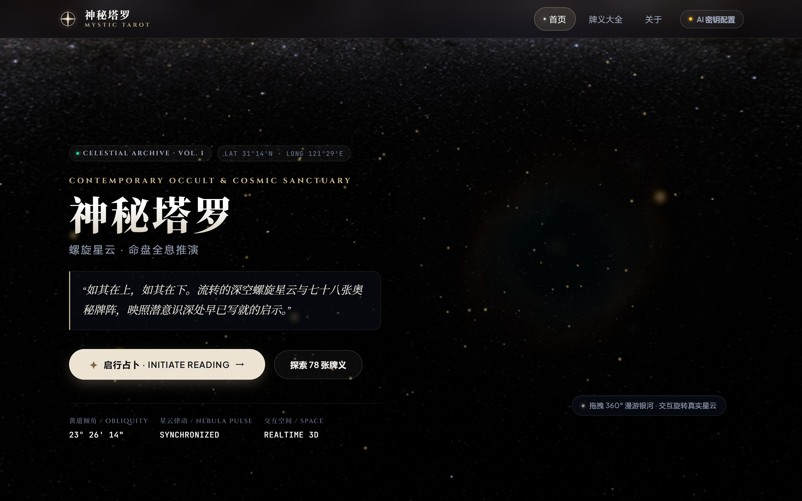
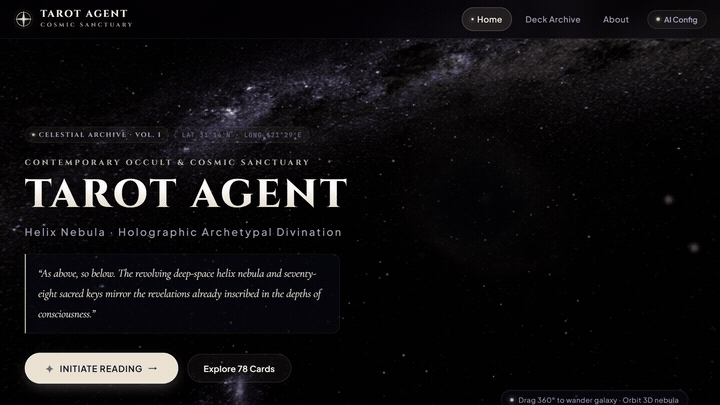
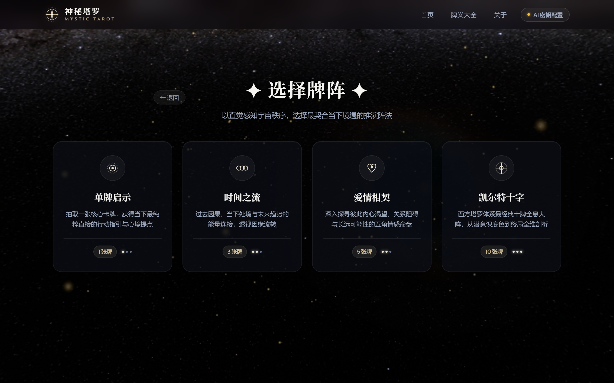
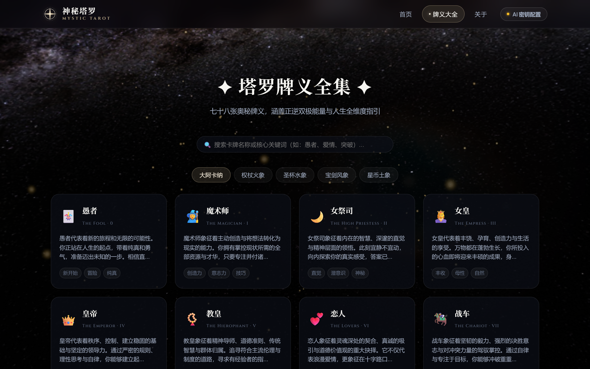
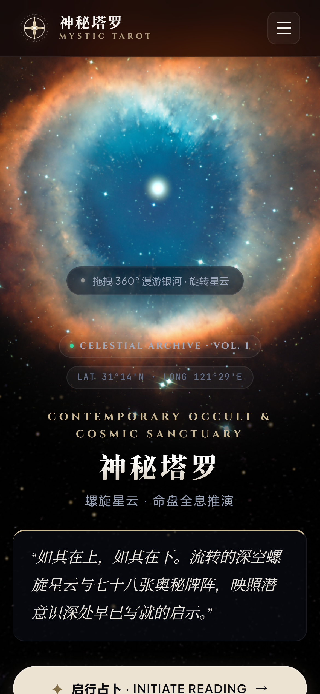
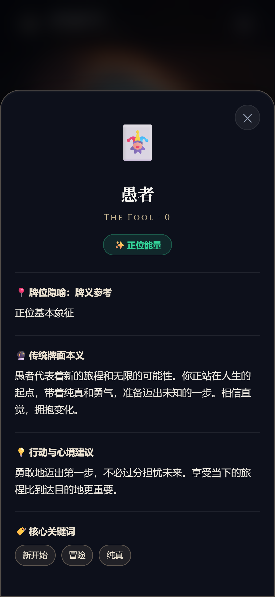

# ✦ Tarot Agent · Cosmic Sanctuary & Archetypal AI Divination

<p align="center">
  
</p>

<p align="center">
  <strong>A digital sanctuary where contemporary design studio aesthetics converge with ancient occult symbolism · Realtime 3D Helix Nebula × 78 Sacred Tarot Archetypes × Conversational AI Spiritual Mentor</strong>
</p>

<p align="center">
  <a href="https://yaohaoliang141-max.github.io/Tarot-Agent-/"><strong>🌐 Live Experience</strong></a> ·
  <a href="#-interactive-3d-preview"><strong>Live Preview</strong></a> ·
  <a href="#-visual-showcase"><strong>Showcase</strong></a> ·
  <a href="#-quick-start"><strong>Quick Start</strong></a> ·
  <a href="#-design-system--tech-stack"><strong>Design System</strong></a>
</p>

<p align="center">
  
  
  
  
  
</p>

---

## 🎬 Interactive 3D Preview

### 🪐 Realtime 3D Helix Nebula & Gravitational Interaction

> Built on procedural Three.js mathematical physics derived from European Southern Observatory (ESO) and Hubble imagery. Features an ionized emerald core, expanding bi-color red gases, and thousands of ambient starfield particles dynamically orbiting with cursor and touch momentum.

<p align="center">
  
</p>

> 💡 **Full HD Video**: A high-definition MP4 demonstration file is included at [`assets/demo.mp4`](assets/demo.mp4).

---

## 📸 Visual Showcase

### 🖥️ Desktop Experience

<table width="100%">
  <tr>
    <td width="50%" align="center">
      
      <br />
      <strong>✦ Cosmic Sanctuary & Studio Typography</strong>
      <p><em>Custom SVG Celestial Oculus brand mark, obsidian void background, and tiered typography</em></p>
    </td>
    <td width="50%" align="center">
      
      <br />
      <strong>✦ Celestial Spreads & Sacred Geometry</strong>
      <p><em>Single Card, Time Stream, Romantic Affinity, and Celtic Cross matrix arrays</em></p>
    </td>
  </tr>
  <tr>
    <td width="50%" align="center">
      
      <br />
      <strong>✦ Clear Verdicts & Conversational AI Mentor</strong>
      <p><em>Unambiguous core conclusions, dual polarities, and streaming multi-turn dialogues</em></p>
    </td>
    <td width="50%" align="center">
      
      <br />
      <strong>✦ Tarot Archive & Archetypal Compendium</strong>
      <p><em>Complete 78 cards with real-time fuzzy search, Roman numerals, and element filters</em></p>
    </td>
  </tr>
</table>

### 📱 Mobile-First & Ergonomic Touch Architecture

> Specifically calibrated for small screens: an unobstructed top 3D nebula aperture (`mobile-nebula-stage`) allows smooth spatial navigation without overlapping typography. Card details and AI settings operate via intuitive iOS / shadcn-style **Bottom Sheets**.

<p align="center">
  
  
  
</p>

---

## ✨ Key Features

- 🪐 **Realtime 3D Helix Nebula Engine** — Procedural shader modeling with damped mouse drag and touch gyroscope tracking.
- 🏛️ **Contemporary Studio Aesthetic** — Synthesized from `UI UX Pro Max` and `shadcn/ui` standards: obsidian background (`#030306`), hairline borders (`rgba(255,255,255,0.08)`), 20px frosted glassmorphism, and restrained satin champagne metallic accents.
- 🔤 **Four-Tier Typography Hierarchy (Fontsource)** — Classical ceremonial serif `Cinzel`, poetic literary serif `Cormorant Garamond`, high-legibility sans `Plus Jakarta Sans`, and astronomical telemetry monospace `JetBrains Mono`.
- ⚜️ **Custom Vector Brand Identity (Logo Design Skill)** — Pure SVG Celestial Oculus brand mark and Sacred Geometry card-back vectors with axial 3D flip physics.
- 🤖 **AI Spiritual Mentor Agent (Multi-Model Support)** — Direct client-side streaming integration with DeepSeek, SiliconFlow, OpenAI (GPT-4o / GPT-4o-mini), Moonshot AI (Kimi), and Zhipu AI (GLM) for in-depth psychological interpretations and follow-up consultations.
- 🎯 **Definitive Conclusions** — Immediate qualitative verdicts (Do / Don't compass, developmental trajectory) rendered right under cards without mandatory modal clicks.
- 🎴 **Full 78-Card Deck Knowledgebase** — 22 Major Arcana + 56 Minor Arcana (Wands, Cups, Swords, Pentacles) with upright and reversed meanings across Love, Career, Health, and Wealth.
- 🔒 **Client-Side Privacy Guarantee** — Zero third-party intermediary servers. All LLM API keys are stored exclusively in your browser's LocalStorage and transmitted directly to the model endpoint.

---

## 🚀 Quick Start

### Option 1: Live Deployment

Visit directly: [https://yaohaoliang141-max.github.io/Tarot-Agent-/](https://yaohaoliang141-max.github.io/Tarot-Agent-/)

### Option 2: Local Execution

This project is zero-build and runs with pure native ES6+ web technologies. Clone and launch any static file server:

```bash
# Clone the repository
git clone https://github.com/yaohaoliang141-max/Tarot-Agent-.git
cd Tarot-Agent-

# Launch with Python 3
python -m http.server 8080

# Or launch with Node.js
npx serve .
```

Open your browser at `http://localhost:8080`.

---

## 🏗️ Project Architecture

```
Tarot-Agent-/
├── assets/                     # HD screenshots, dynamic preview GIF, and demo MP4
│   ├── hero-desktop.png        # Desktop landing page preview
│   ├── spreads-desktop.png     # Spread selection view
│   ├── reading-result-desktop.png # Divination results and AI chat
│   ├── meanings-desktop.png    # 78-card meanings archive
│   ├── mobile-hero.png         # Mobile nebula stage preview
│   ├── mobile-result.png       # Mobile result layout
│   ├── mobile-drawer.png       # Mobile bottom sheet drawer
│   ├── preview.gif             # 3D nebula interaction GIF
│   └── demo.mp4                # High-definition video showcase
├── css/
│   └── style.css               # Design Tokens, components, responsive layout & animations
├── js/
│   ├── tarot-data.js           # 78 Tarot cards full English database & spreads
│   ├── celestial-astrolabe.js  # Three.js 3D Helix Nebula & starfield system
│   └── app.js                  # Routing, card dealing, offline verdicts & AI stream
├── index.html                  # Semantic single-page application entry point
├── LICENSE                     # MIT License
└── README.md                   # Project documentation
```

---

## 🛠️ Design System & Tech Stack

| Domain | Library / Specification | Application |
| :--- | :--- | :--- |
| **3D Celestial Physics** | [Three.js](https://threejs.org/) | Procedural mathematical nebula particles, camera frustum calibration, orbital panning |
| **Design System** | [UI UX Pro Max](https://github.com/nextlevelbuilder/ui-ux-pro-max-skill) | Global `:root` Design Tokens, obsidian palette, spacing & elevation scales |
| **UI Components** | [shadcn/ui](https://github.com/shadcn-ui/ui) | Glassmorphic cards, hairline borders, segmented controls, mobile Bottom Sheet |
| **Micro-Interactions** | [React Bits](https://github.com/DavidHDev/react-bits) & [Magic UI](https://github.com/magicuidesign/magicui) | Perspective card tilt, subtle border glow, smooth deal & flip animations |
| **Typography** | [Fontsource](https://github.com/fontsource/fontsource) | Cinzel / Cormorant Garamond / Plus Jakarta Sans / JetBrains Mono |
| **Brand Identity** | [Logo Design Skill](https://github.com/kaankiziltug/logo-design-skill) | Custom vector Celestial Oculus badge and Sacred Geometry card backs |
| **AI Archetype Agent** | OpenAI API Compatible | Streaming LLM integration (DeepSeek, SiliconFlow, OpenAI, Kimi, GLM) |

---

## 🎯 Divination Workflow

1. **Select Spread**: Choose from Single Revelation, Time Stream, Romantic Affinity, or Celtic Cross;
2. **Meditate on Query**: Enter an optional question and select your domain of focus (General, Love, Career, Health, Wealth);
3. **Instinctive Draw**: Feel the cosmic resonance and draw your destined cards from the 3D-tilted deck;
4. **Immediate Verdict**: Review the synthesized affirmative/cautionary judgment directly below the cards;
5. **AI Master Follow-Up**: Inquire further with the AI Spiritual Mentor for concrete next steps, timing, and subconscious nuances.

---

## 📄 License

Licensed under the [MIT License](LICENSE). Feel free to adapt, extend, and explore!
